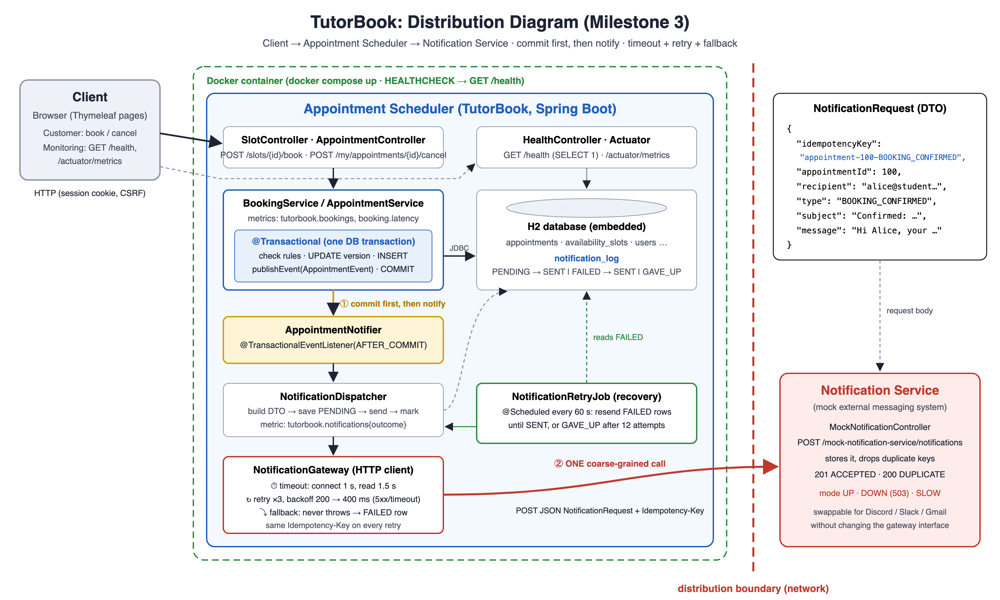

# TutorBook: Tutoring Center Appointment System

**SJSU CMPE 172 Term Project, Milestone 3 (Integration, Distribution & Deployment)**
Author: Samuel Dinkayehu

TutorBook lets students (**customers**) browse and book tutoring sessions with tutors (**providers**). It is built with **Java 17+, Spring Boot, and plain SQL over JDBC (`JdbcClient`), with no ORM**, plus Spring Security session login and Thymeleaf pages.

Milestone 2 adds the full booking workflow: a role-based login with BCrypt passwords, booking, owner-only cancel, my appointments, and provider slot management. Bookings are safe under concurrency through a `@Transactional` booking with an **optimistic version check and retry**, backed by a database **unique constraint**. The Milestone 1 version is tagged [`milestone-1`](../../tree/milestone-1).

Milestone 3 makes the system production-shaped: booking and cancelling send a **confirmation through a mock external notification service** across an HTTP distribution boundary, with **timeout, retry, fallback and commit-then-notify**. It also adds **logging, `GET /health`, custom metrics, a Dockerfile + docker-compose, and a GitHub Actions CI pipeline**.


## How to run

**You need:** JDK 17 or newer (`java -version`). You do not need to install Maven or a database. The Maven wrapper (`mvnw`) downloads Maven, and the database is an embedded H2 created in memory.

```bash
git clone <this-repo-url>
cd cmpe172-tutorbook
./mvnw spring-boot:run          # Windows: mvnw.cmd spring-boot:run
```

Then open **http://localhost:8080**.

**With Docker** (no JDK needed):

```bash
docker compose up --build       # http://localhost:8080 ; health: http://localhost:8080/health
docker compose down
```

Run the tests (72 tests, including the two-thread concurrency test and the notification-outage integration tests):

```bash
./mvnw test
```

## Log in

| Role | Email | Password |
|---|---|---|
| Customer | alice@student.sjsu.edu (also bob@, chen@) | password123 |
| Provider | dr.patel@tutorbook.edu (also j.kim@, m.garcia@, d.okafor@) | password123 |

Passwords are stored as BCrypt hashes. On login, the role is read from the `users` row over JDBC and kept in the server-side session.

## Endpoints

| Method | URL | Who | What |
|---|---|---|---|
| GET | `/` | anyone | Home page |
| GET | `/slots` | anyone | Available slots. Filter by `providerId`, `serviceId`, `date`; paginate with `page`, `size` (SQL `LIMIT`/`OFFSET`) |
| GET / POST | `/slots/{id}/book` | customer | Booking form / book the slot |
| GET | `/appointments/{id}/confirmation` | the appointment's customer or provider | Confirmation |
| GET | `/my/appointments` | customer | Upcoming + history (BOOKED / CANCELLED / COMPLETED) |
| POST | `/my/appointments/{id}/cancel` | owner only | Cancel |
| GET / POST | `/provider/slots` | provider | My slots / create a slot for a service |
| POST | `/provider/slots/{id}/remove` | owning provider | Remove an unbooked slot |
| GET | `/provider/appointments` | provider | Appointments booked with me |
| GET | `/api/slots`, `/api/providers`, `/api/services` | anyone | JSON |
| GET | `/health` | anyone | Health: database check (`SELECT 1`) + notification backlog. `UP`, `DEGRADED` (200) or `DOWN` (503) |
| GET | `/actuator/metrics/{name}` | anyone | Metrics, e.g. `tutorbook.bookings`, `tutorbook.booking.latency`, `tutorbook.bookings.last_hour`, `tutorbook.notifications` |
| POST | `/mock-notification-service/notifications` | the app's gateway | Mock external notification service (JSON `NotificationRequest`) |
| GET | `/mock-notification-service/notifications` | anyone | What the mock service has "sent" |
| PUT | `/mock-notification-service/mode/{UP\|DOWN\|SLOW}` | demo | Simulate an outage |

**Status codes:** `400` invalid input · `403` wrong role or not the owner · `404` not found · `409` slot conflict. Errors never include stack traces.

## Concurrency design (double-booking)

1. `BookingService.book()` loops for up to 3 attempts.
2. Each attempt is `BookingTransaction.tryBook()`, which is `@Transactional(isolation = READ_COMMITTED)`. It:
   - reads the slot and its `version`;
   - checks the rules (exists, in the future, not booked);
   - runs `UPDATE availability_slots SET version = version + 1 WHERE slot_id = ? AND version = ?`. If 0 rows change, someone else got there first, so it throws `OptimisticConflictException`, which triggers a retry;
   - inserts the appointment.
3. On retry, the slot now reads as booked, so the request returns **409**.
4. Backstop: `UNIQUE(active_slot_id)` on `appointments` makes a second active booking impossible, even if the application logic had a bug.

`ConcurrentBookingTest` runs 2 threads (and 8 threads) booking the same slot at the same instant and asserts that **exactly one succeeds**.

## Distribution boundary (Milestone 3)



`Client → Appointment Scheduler → Notification Service`

1. **Commit first, then notify.** `BookingTransaction.tryBook` / `AppointmentService.cancel` publish an `AppointmentEvent` inside their transaction. `AppointmentNotifier` is a `@TransactionalEventListener(phase = AFTER_COMMIT)`, so it runs only after the commit. A rollback means no notification, and no database lock is held while waiting on the network.
2. **Coarse-grained DTO.** One `NotificationRequest` (`idempotencyKey`, `appointmentId`, `recipient`, `type`, `subject`, `message`) carries everything the remote service needs, in one HTTP call. It never calls back.
3. **Gateway with fault handling.** `HttpNotificationGateway`: connect timeout 1 s, read timeout 1.5 s; retry up to 3 times with backoff 200 → 400 ms on timeouts, connection errors, 5xx and 429; no retry on other 4xx. **Fallback:** it never throws, and the notification is saved in `notification_log` as `FAILED`.
4. **Idempotent retries.** Every attempt sends the same `Idempotency-Key` (`appointment-12-BOOKING_CONFIRMED`). The mock service stores a key once and answers `DUPLICATE` after that, and `notification_log.idempotency_key` is `UNIQUE`.
5. **Recovery.** `NotificationRetryJob` resends `FAILED` notifications every 60 s, until `SENT` or `GAVE_UP` after 12 attempts.

To simulate an outage: `curl -X PUT localhost:8080/mock-notification-service/mode/DOWN`, book a slot (it still succeeds), check `GET /health` (it is `DEGRADED`), then set the mode back to `UP`. Within a minute the retry job delivers the notification.

## Architecture

```
Browser ──HTTP──▶ Controller ──▶ Service ──▶ Repository ──JDBC/SQL──▶ H2 database
 (Thymeleaf HTML   (@Controller /   (@Service:   (@Repository:
  or JSON)         @RestController)  logic,      JdbcClient +
                                     DTO mapping) RowMapper)
```

```
src/main/java/edu/sjsu/cmpe172/tutorbook/
├── config/       SecurityConfig (login, RBAC, BCrypt), TimeConfig
├── security/     AppUser, JdbcUserDetailsService (loads users over JDBC)
├── controller/   Home, Slot, Appointment, Provider, Login controllers (HTML, Page Controller)
│                 CatalogApiController (JSON)
├── notification/ NotificationRequest DTO, NotificationGateway + HttpNotificationGateway (timeout/retry/fallback),
│                 AppointmentNotifier (AFTER_COMMIT), NotificationDispatcher, NotificationRetryJob, NotificationRepository
├── mocknotification/ MockNotificationController + MockNotificationService (the mock external service)
├── service/      BookingService (retry, metrics) + BookingTransaction (@Transactional), AppointmentService,
│                 ProviderSlotService, CatalogService, SlotService, AppointmentStatusJob
├── repository/   User, Provider, ServiceOffering, Slot, Appointment repositories (SQL)
├── model/        Records that mirror database rows
├── dto/          Records sent to the view/JSON (HomeDto, SlotDto, PageDto, ...)
└── exception/    GlobalExceptionHandler (HTML) + ApiExceptionHandler (JSON) → 400/403/404/409
src/main/resources/
├── schema.sql    5 tables + constraints + the double-booking guard
├── seed.sql      sample users, providers, services, slots, appointments
├── templates/    Thymeleaf pages (home, slots, book, confirmation)
└── application.properties
```

## Double-booking guard

`appointments.active_slot_id` is a generated column. It equals `slot_id` while the appointment's status is `BOOKED` and is `NULL` once the appointment is `CANCELLED`. The table has `UNIQUE (active_slot_id)`, so the **database** allows at most one active booking per slot, even when two requests arrive at the same instant. Cancelled rows are kept as history, and the slot can be booked again. `DoubleBookingGuardTest` proves this. Since Milestone 2 this constraint is the backstop behind the optimistic version check.

## Roadmap

- **M1:** design, schema, seed, layered read-only skeleton (tag `milestone-1`)
- **M2:** features 1–8 (logins, filter/paginate, book, my appointments, cancel, provider slot management)
- **M3 (this):** mock notification service behind a gateway (timeout, retry, fallback, commit-then-notify), logging, `/health`, metrics, Docker, GitHub Actions CI
- **M4:** AI booking agent, autonomous agent, grounded Q&A (RAG)

## Design documents

See [`docs/`](docs): **[Milestone 3 Report](docs/Milestone3_Report.pdf)** · [Distribution Diagram](docs/Distribution_Diagram.png) · [Milestone 2 Report](docs/Milestone2_Report.pdf) · [Race condition diagram](docs/Race_Condition.png) · [Milestone 1 Report](docs/Milestone1_Report.pdf) · [ER Diagram](docs/ER_Diagram.png) · [Relational Schema](docs/Relational_Schema.pdf) · [Wireframes](docs/Wireframes.pdf) · [Block Diagram](docs/Block_Diagram.png)
